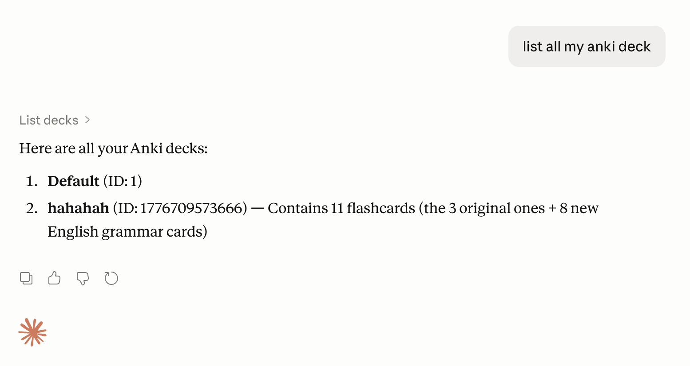

# MCP Integration

The anki-cloud MCP server exposes 11 tools to LLMs, enabling seamless LLM-to-Anki workflows.
Any MCP-compatible client (Claude Desktop, API clients) can create decks, add flashcards,
search notes, and more — without the user having Anki open.

## Prerequisites

1. A running anki-cloud instance (local or hosted) — see [SELF_HOSTING.md](SELF_HOSTING.md)
2. [Bun](https://bun.sh) installed locally
3. An API key — generate one in the web UI under **Account → API Keys**

## Claude Desktop Setup

Claude Desktop spawns the MCP server as a child process over stdio. Each user configures
their own key — the server runs locally on their machine.

Add the following to your Claude Desktop config file:

- **Mac:** `~/Library/Application Support/Claude/claude_desktop_config.json`
- **Windows:** `%APPDATA%\Claude\claude_desktop_config.json`

```json
{
  "mcpServers": {
    "anki-cloud": {
      "command": "bun",
      "args": [
        "run",
        "/absolute/path/to/anki-cloud/mcp/src/index.ts"
      ],
      "env": {
        "API_URL": "http://localhost:3000",
        "API_KEY": "ak_your_key_here"
      }
    }
  }
}
```

Replace `/absolute/path/to/anki-cloud` with the actual path to your clone and
`ak_your_key_here` with your API key. For a hosted instance, set `API_URL` to
`https://your-anki-cloud-instance.com`.

Restart Claude Desktop after saving. The "anki-cloud" server should appear in the
tools panel (hammer icon).

**Verify:** Ask Claude _"List my Anki decks"_ — it calls `list_decks` and shows results.

## Environment Variables

| Variable        | Default                 | Description                                                    |
|-----------------|-------------------------|----------------------------------------------------------------|
| `API_URL`       | `http://localhost:3000` | Base URL of the anki-cloud REST API                            |
| `API_KEY`       | _(stdio only)_          | API key with `ak_` prefix; ignored in HTTP mode                |
| `MCP_TRANSPORT` | `stdio`                 | `stdio` (local) or `http` (remote, Streamable HTTP)            |
| `MCP_PORT`      | `3001`                  | Listen port in HTTP mode                                       |

## Remote (HTTP) mode

With `MCP_TRANSPORT=http` the server listens on `POST /mcp` (Streamable HTTP, stateless) and `GET /healthz`.
There is no process-wide key: each request must carry `Authorization: Bearer ak_...`, which is forwarded to the
REST API, so one server instance serves many users. A missing header returns `401`. An invalid key surfaces as a
tool error from the REST API. `GET`/`DELETE /mcp` return `405` (no sessions, no server-initiated streams).

```bash
MCP_TRANSPORT=http API_URL=http://localhost:3000 bun run mcp/src/index.ts
```

Every request is validated against the REST API (`GET /v1/whoami`) first, so a wrong, revoked or expired credential
gets a real `401` rather than a tool error.

### OAuth 2.1 (Claude custom connectors)

The REST API is the authorization server (Better Auth `mcp` plugin) and the MCP server is the protected resource.
Set on the API and the MCP server:

| Variable         | Example                  | Description                                          |
|------------------|--------------------------|------------------------------------------------------|
| `MCP_PUBLIC_URL` | `https://mcp.example.com`   | Public URL of the MCP server (the OAuth resource)    |
| `OAUTH_ISSUER`   | `https://example.com`       | Origin of the API, which serves the OAuth endpoints  |
| `FRONTEND_URL`   | `https://example.com`       | The web login page users are sent to when signing in |

Flow: the client gets `401` with `WWW-Authenticate: Bearer resource_metadata=...`, reads
`/.well-known/oauth-protected-resource` from the MCP server, then
`/.well-known/oauth-authorization-server` from the issuer, registers itself (RFC 7591), and runs authorization code
with PKCE. Users sign in through the normal web login. Access tokens last 1 hour and refresh tokens 30 days. The
issuer's `/.well-known/oauth-authorization-server` must be reachable at the origin root. `ak_` keys keep working.

Add it in Claude: Settings → Connectors → Add custom connector → `https://mcp.example.com/mcp`.

---

## Tools Reference

### `list_decks`

List all decks in the user's collection.

**Inputs**

| Parameter | Type   | Required | Description                              |
|-----------|--------|----------|------------------------------------------|
| `limit`   | number | no       | Max results (1–1000, default 100)        |
| `cursor`  | string | no       | Pagination cursor from previous response |

**Example prompt**
> "List all my Anki decks."

**Example response**



---

### `get_deck`

Get details of a specific deck by ID.

**Inputs**

| Parameter | Type   | Required | Description                 |
|-----------|--------|----------|-----------------------------|
| `id`      | string | yes      | Deck ID (from `list_decks`) |

**Example prompt**
> "Get details of deck 1700000000001."

**Example response**

```json
{
  "id": "1700000000001",
  "name": "Spanish Vocabulary"
}
```

---

### `create_deck`

Create a new deck. Use `::` for subdecks (e.g. `Languages::Spanish`).

**Inputs**

| Parameter | Type   | Required | Description                                  |
|-----------|--------|----------|----------------------------------------------|
| `name`    | string | yes      | Deck name, e.g. `Python` or `CS::Algorithms` |

**Example prompt**
> "Create a deck called 'Python'."

**Example response**

```json
{
  "id": "1700000000042",
  "name": "Python"
}
```

---

### `create_note`

Add a single flashcard to a deck. The default Anki note type uses `Front` and `Back` fields.

**Inputs**

| Parameter    | Type             | Required | Description                          |
|--------------|------------------|----------|--------------------------------------|
| `deckId`     | string           | yes      | Target deck ID                       |
| `fields`     | object           | yes      | Map of field name → value            |
| `tags`       | array of strings | no       | Tags to apply                        |
| `noteTypeId` | string           | no       | Note type ID (omit for deck default) |

**Example prompt**
> "Add a flashcard to my Python deck: Front = 'What is a list comprehension?', Back = 'A concise way to create lists: [expr for item in iterable]'."

**Example response**

```json
{
  "id": "1700000000123"
}
```

---

### `create_notes_bulk`

Add multiple flashcards in a single request. Prefer this over repeated `create_note` calls.

**Inputs**

| Parameter            | Type   | Required | Description                   |
|----------------------|--------|----------|-------------------------------|
| `deckId`             | string | yes      | Target deck ID                |
| `notes`              | array  | yes      | Array of note objects (min 1) |
| `notes[].fields`     | object | yes      | Field map for each note       |
| `notes[].tags`       | array  | no       | Tags for each note            |
| `notes[].noteTypeId` | string | no       | Note type for each note       |

**Example prompt**
> "Add 3 flashcards about the water cycle to my Science deck."

**Example response**

```json
{
  "ids": [
    "1700000000124",
    "1700000000125",
    "1700000000126"
  ]
}
```

---

### `search_notes`

Search notes using [Anki search syntax](https://docs.ankiweb.net/searching.html).

**Inputs**

| Parameter | Type   | Required | Description                       |
|-----------|--------|----------|-----------------------------------|
| `query`   | string | yes      | Anki search query                 |
| `limit`   | number | no       | Max results (1–1000, default 100) |
| `cursor`  | string | no       | Pagination cursor                 |

**Common query examples**

| Query          | Finds                                |
|----------------|--------------------------------------|
| `tag:python`   | Notes tagged "python"                |
| `deck:Spanish` | Notes in the Spanish deck            |
| `added:7`      | Notes added in the last 7 days       |
| `front:hola`   | Notes with "hola" in the Front field |

**Example prompt**
> "Search my notes for tag:python."

**Example response**

```json
{
  "notes": [
    {
      "id": "1700000000123",
      "noteTypeId": "1",
      "tags": [
        "python"
      ],
      "fields": {
        "Front": "What is a decorator?",
        "Back": "A function that wraps another function."
      }
    }
  ],
  "nextCursor": null
}
```

---

### `update_note`

Edit a note's fields and/or tags. **All fields are replaced** — include all fields, not just changed ones.

**Inputs**

| Parameter | Type             | Required | Description                                  |
|-----------|------------------|----------|----------------------------------------------|
| `id`      | string           | yes      | Note ID to update                            |
| `fields`  | object           | yes      | Complete new field map (replaces all fields) |
| `tags`    | array of strings | no       | New tag list (replaces all existing tags)    |

**Example prompt**
> "Update note 1700000000123: change the Back field to 'A function that modifies another function, often using @syntax'."

**Example response**

```json
{
  "ok": true
}
```

---

### `delete_note`

Permanently delete a note and all cards generated from it. Cannot be undone.

**Inputs**

| Parameter | Type   | Required | Description       |
|-----------|--------|----------|-------------------|
| `id`      | string | yes      | Note ID to delete |

**Example prompt**
> "Delete note 1700000000123."

**Example response**

```json
{
  "ok": true
}
```

---

## Example Workflows

**Create a deck and populate it from a conversation:**
> "We just discussed Python decorators. Create a deck called 'Python' and add 5 flashcards
> covering the key concepts from our discussion."

**Bulk import from structured content:**
> "Here's a vocabulary list. Add all of these to my Spanish deck as Front/Back flashcards: ..."

**Review and update existing notes:**
> "Search my notes for tag:python and show me the ones about decorators. Update the Back field
> of each one to include a code example."

---

## Troubleshooting

**"Server disconnected" in Claude Desktop**

- Check the `args` path is absolute and correct: `ls /your/path/to/anki-cloud/mcp/src/index.ts`
- Check `bun` is on PATH: `which bun` in a terminal
- Check the API is running: `curl http://localhost:3000/health`

**"INVALID_API_KEY" errors**

- Verify the key starts with `ak_` and was copied in full
- Keys are shown only once on creation — generate a new one if lost

**Tool calls succeed but no notes appear in Anki**

- Sync Anki Desktop against the server: **Sync** button in Anki
- Verify Google Drive is connected in the web UI under **Account → Storage**

**Claude doesn't show the anki-cloud tools**

- Fully quit and relaunch Claude Desktop (menu bar → Quit, not just close window)
- Check the config file is valid JSON: `cat ~/Library/Application\ Support/Claude/claude_desktop_config.json | python3 -m json.tool`

---

## Review tools (spaced repetition)

These let an LLM quiz you on your **scheduled** cards. Reviews are recorded by the real
scheduler, so they sync to your other devices like any review done there.

| Tool | Purpose |
|------|---------|
| `get_review_counts` | New / learning / review cards due in a deck (`deckId`). No card content. |
| `get_due_cards` | Next due cards (`deckId`, `limit` 1–20, default 5): `cardId`, plain-text `question` and `answer`, `state`, and the interval each rating would give. Reading does not consume cards. |
| `answer_card` | Record a grade (`cardId`, `rating`: `again` \| `hard` \| `good` \| `easy`, optional `millisecondsTaken`). Call only after the user confirmed the grade. |

REST equivalents: `GET /v1/review/next`, `GET /v1/review/counts`, `POST /v1/review/answer`.

### Study skill for Claude Desktop

`skills/anki-review/` contains a Claude Skill that runs the whole session: it paraphrases each
question (so you can't answer from visual memory), compares your answer with the card, proposes a
grade, and records it only after you press **1** (Again), **2** (Hard), **3** (Good) or **4** (Easy).

Install: upload `skills/anki-review/SKILL.md` (or `skills/anki-review/anki-review.skill`) in Claude Desktop under
**Settings → Capabilities → Skills**, then say _"Quiz me on my Rust deck"_.

For cards with media, the skill fetches the image, SVG or audio with `get_media` and shows it before it
asks the question. It never names the file (names can give the answer away). It cannot hear audio: you
play the clip yourself, and your answer is graded from the card's text.

---

## Media tools (images and audio)

Cards can reference files in your collection's media folder: `` for images and
`[sound:clip.mp3]` for audio. These tools let an LLM add, find, look at and delete those files.
Media syncs to your other devices like any other change.

<!-- MEDIA-LIMITS: the types and caps below repeat anki-cloud-sync/sync-storage-server/src/media.rs. Update them together. -->
**Allowed types:** png, jpg, gif, webp, svg, mp3, ogg, wav, m4a, 3gp, amr. The type is detected from the
file's bytes, not its name or `Content-Type`.
**Size limits:** images 5 MB, audio 10 MB, SVG 200 KB.

| Tool | Purpose |
|------|---------|
| `request_media_upload` | Returns a one-time link where **you** upload an image or audio file from your device. Single use, valid for 5 minutes, treat it as a secret. |
| `add_svg_media` | Stores an SVG the LLM writes itself (`name`, `content`). Scripts and external references are stripped. Returns the stored name, which may differ from the requested one. |
| `list_media` | Lists files with sizes (`limit` 1–1000, `cursor`). |
| `get_media_info` | Detected type, size and, for raster images, width and height. Does not download the file. |
| `get_media` | Fetches the file so the LLM can look at it: images as images, SVG as text, audio as audio. Downloads the whole file. |
| `delete_media` | Deletes a file (removed on your devices at the next sync). Notes that use it show a broken image or no sound. The LLM should confirm first. |

### Why uploads go through a link

MCP tool calls carry text, so an LLM cannot send a PNG or an MP3 through them. The two ways in:

- **SVG:** the LLM writes the markup and calls `add_svg_media`. Nothing else to do.
- **Everything else:** the LLM calls `request_media_upload` and gives you the link. Open it, choose the file,
  and tell the LLM when you are done. It then calls `list_media` to find the stored name and puts the
  snippet in a note field.

**Example prompts**
> "Draw a diagram of the water cycle as an SVG and add a card to my Science deck that uses it."
>
> "I want to add a photo of a heart to my Anatomy deck. Give me an upload link."
>
> "What media files do I have? Delete the unused ones."

**Example response** of `add_svg_media`:

```json
{
  "name": "water-cycle.svg",
  "added": true,
  "mimeType": "image/svg+xml",
  "size": 2310,
  "html": ""
}
```

### Limits of the LLM

- It cannot hear audio. It can fetch and relay a clip, but you play it, and it grades from the card text only.
- A file is typed by its bytes: a text file renamed `.png` is rejected as an unsupported type.
- Files over the size limits are rejected with a clear message. Over-limit SVGs need a simpler drawing, not an
  upload link.

REST equivalents: `POST /v1/media` (multipart), `POST /v1/media/svg`, `POST /v1/media/upload-links`,
`GET /v1/media`, `GET /v1/media/{name}/metadata`, `GET /v1/media/{name}`, `DELETE /v1/media/{name}`.
